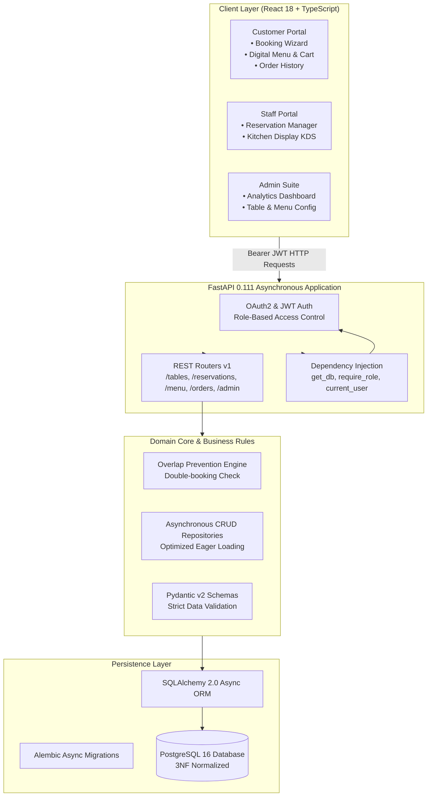
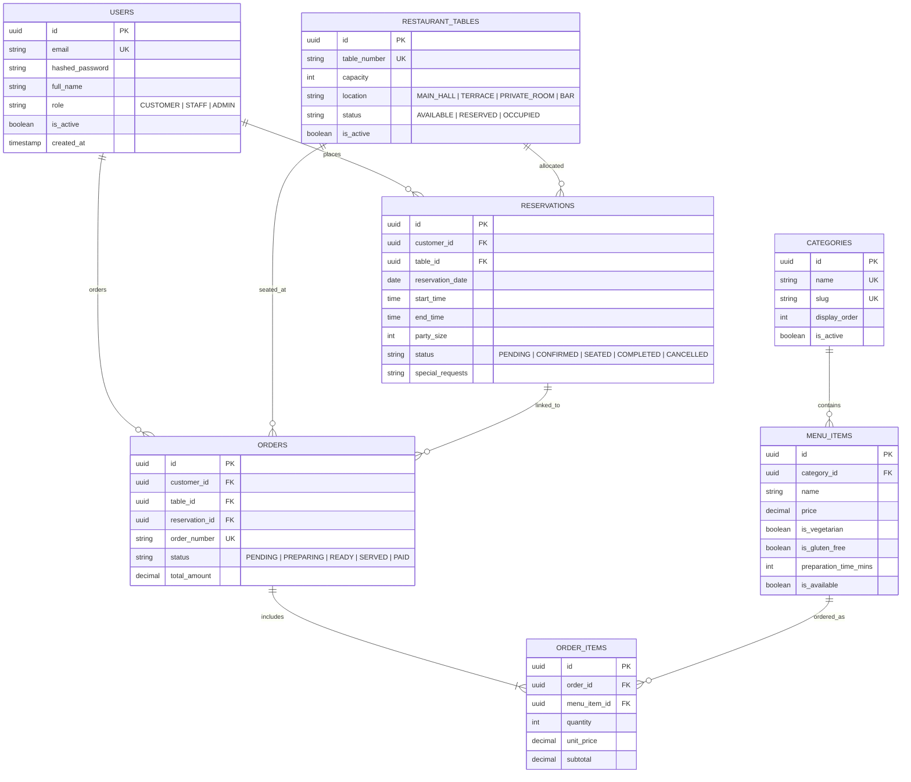

# SavoryByte — Production SaaS Restaurant Reservation & Management System

> **A real-world, enterprise-grade Restaurant Reservation and Operational Management SaaS platform built with Clean Architecture, Domain-Driven Design, and modern Full-Stack engineering practices.**

[](.github/workflows/ci.yml)
[](https://fastapi.tiangolo.com)
[](https://docs.sqlalchemy.org)
[](https://react.dev)
[](https://tailwindcss.com)
[](https://www.postgresql.org)
[](https://www.docker.com)

---

## 🏛️ System Architecture

SavoryByte is engineered following **Clean Architecture** principles, strictly decoupling business logic from external frameworks, persistence mechanisms, and user interfaces.



---

## ✨ Key Features & Capabilities

### 1. 🍽️ Customer Dining Experience
* **Interactive Table Booking Wizard**: Real-time table selection by dining location (`Main Hall`, `Terrace`, `Private Room`, `Bar`) and guest capacity.
* **Overlap Prevention Algorithm**: Backend guarantees zero double-bookings using mathematically sound interval collision checks ($A_{\text{start}} < B_{\text{end}} \land A_{\text{end}} > B_{\text{start}}$) with immediate `409 Conflict` feedback.
* **Digital Gourmet Menu & Cart**: Filter dishes by category, view dietary badges (`Vegetarian`, `Gluten-Free`, preparation times), search items, and submit live food orders.
* **Self-Service Customer Portal**: View live booking statuses (`PENDING`, `CONFIRMED`, `SEATED`, `COMPLETED`, `CANCELLED`) and cancel bookings directly.

### 2. 👨‍🍳 Staff Operational Command
* **Real-Time Reservation Manager**: Manage all bookings with 15-second automatic polling, status filtering, and one-click state transitions (*Confirm*, *Seat Guest*, *Complete*, *Cancel*, *No Show*).
* **Live Kitchen Display System (KDS)**: Kanban-style order board (`Pending` → `Preparing` → `Ready` → `Served`) with live elapsed time counters and 10-second automatic queue refresh.

### 3. 👑 Executive Admin Control Center
* **Live SaaS Analytics Dashboard**: Real-time KPIs tracking **Total Paid Revenue**, **Today's Active Reservations**, **Active Table Count**, and **Registered Customer Base**.
* **Table Management**: Add, configure, activate, and remove dining tables across zones.
* **Menu Management**: Create menu categories and publish gourmet dishes with prices, preparation times, and dietary restrictions.

### 4. 🔒 Enterprise Security & RBAC
* **Password Security**: Native `bcrypt` salted password hashing (truncated to 72 bytes for maximum compatibility).
* **Token Management**: Dual JWT token system (Short-lived Access Token + Persistent Refresh Token) with automatic Authorization header injection.
* **Hierarchical Role Guards**: Reusable FastAPI `Depends(require_role([UserRole.ADMIN, ...]))` securing every sensitive endpoint.

---

## 📊 Database Schema (3NF Normalized)



---

## ⚡ Quickstart Guide

### Option A: 1-Command Docker Compose (Recommended)

Run the entire production stack (PostgreSQL, Backend API, Frontend App) with one command:

```bash
# Clone the repository
git clone https://github.com/your-org/savorybyte.git
cd savorybyte

# Build and start all services
docker compose up --build
```

Access the applications:
* **Frontend Web App**: [http://localhost:5173](http://localhost:5173)
* **Backend API Documentation (Swagger)**: [http://localhost:8000/docs](http://localhost:8000/docs)
* **API Health Check**: [http://localhost:8000/health](http://localhost:8000/health)

---

### Option B: Local Development Setup

#### 1. Backend Setup (FastAPI + PostgreSQL)

```bash
cd backend

# Create and activate virtual environment
python -m venv venv
# Windows:
.\venv\Scripts\activate
# macOS/Linux:
source venv/bin/activate

# Install dependencies
pip install -r requirements.txt

# Run database migrations
alembic upgrade head

# Seed initial database records (Users, Tables, Menu, Orders)
python scripts/seed_db.py

# Start FastAPI development server
uvicorn app.main:app --reload --port 8000
```

#### 2. Frontend Setup (React + Vite + TypeScript)

```bash
cd frontend

# Install npm packages
npm install

# Start Vite dev server
npm run dev
```

---

## 🔑 Default Test Credentials

The database seeder (`backend/scripts/seed_db.py`) creates three pre-configured accounts:

| Role | Email | Password | Allowed Access |
| :--- | :--- | :--- | :--- |
| **👑 Executive Admin** | `admin@savorybyte.com` | `AdminSecret123!` | Full System, Executive Dashboard, Table/Menu CRUD |
| **👔 Staff / Maitre D'** | `staff@savorybyte.com` | `StaffSecret123!` | Reservation Manager, Live Kitchen Display (KDS) |
| **🥂 Customer / VIP** | `customer@savorybyte.com` | `CustomerSecret123!` | Table Booking Wizard, Digital Menu, Order History |

---

## 🧪 Testing & Verification

### Backend Automated Test Suite (Pytest)
```bash
cd backend
.\venv\Scripts\pytest.exe -v
# Output: 15 passed in 5.83s (100% test pass rate)
```

### Backend Linter & Formatter (Ruff)
```bash
cd backend
.\venv\Scripts\ruff.exe check app
# Output: All checks passed!
```

### Frontend Type-Checking & Production Build
```bash
cd frontend
npm run lint
npm run build
# Output: 0 errors, 0 warnings. Built cleanly in 3.10s.
```

---

## 📁 Repository Structure

```
restaurant-reservation-system/
├── .github/
│   └── workflows/ci.yml         # Automated GitHub Actions CI pipeline
├── backend/
│   ├── alembic/                 # Async database schema migrations
│   ├── app/
│   │   ├── api/v1/              # REST API domain routers (auth, tables, reservations, menu, orders, admin)
│   │   ├── core/                # Config, async database engine, security, RBAC dependencies
│   │   ├── crud/                # Domain CRUD repositories & collision prevention logic
│   │   ├── models/              # SQLAlchemy 2.0 async ORM database entities
│   │   ├── schemas/             # Pydantic v2 request/response schemas
│   │   └── tests/               # Pytest async test suite (15 integration/unit tests)
│   ├── scripts/
│   │   └── seed_db.py           # Database seeder (Admin, Staff, Tables, Menu, Reservations)
│   ├── Dockerfile               # Production multi-stage Docker build
│   └── requirements.txt         # Pinned backend dependencies
├── frontend/
│   ├── src/
│   │   ├── components/          # Reusable UI primitives (Button, Card, Badge, Modal, Navbar, Footer)
│   │   ├── pages/
│   │   │   ├── admin/           # AdminDashboard, ManageTables, ManageMenu
│   │   │   ├── customer/        # BookTable, DigitalMenu, MyReservations, MyOrders
│   │   │   ├── public/          # Login, Register
│   │   │   └── staff/           # StaffDashboard, KitchenDisplay
│   │   ├── services/            # Typed API client with JWT bearer interceptor
│   │   ├── store/               # AuthContext & useAuth custom hooks
│   │   └── types/               # TypeScript domain interfaces matching backend models
│   ├── Dockerfile               # Frontend Nginx container
│   └── package.json             # Frontend dependencies & scripts
├── docker-compose.yml           # Multi-container orchestration
└── README.md                    # Project documentation
```

---

## 💼 Portfolio Highlights & Architecture Decisions

1. **Async-First Python Architecture**: Utilized Python 3.12+ `async/await` across all database I/O using SQLAlchemy 2.0 Async and AsyncPG, preventing thread blocking under high concurrency.
2. **Double-Booking Mathematical Guarantee**: Prevented race conditions and reservation overlaps at the database query level with interval arithmetic ($A_{\text{start}} < B_{\text{end}} \land A_{\text{end}} > B_{\text{start}}$).
3. **Lazy-Loading Mitigation**: Handled async relationship queries with explicit `selectinload` chains to eliminate `MissingGreenlet` exceptions during Pydantic schema serialization.
4. **Resilient Frontend State Management**: Integrated TanStack Query for background caching, query deduplication, and automated polling intervals (10s for Kitchen KDS, 15s for Maitre D' dashboard, 30s for Admin KPIs).
5. **Strict Type Safety**: End-to-end type parity between Pydantic v2 schemas and TypeScript interfaces with runtime Zod form validation.

---

## 📄 License
This project is open-source and available under the [MIT License](LICENSE).
